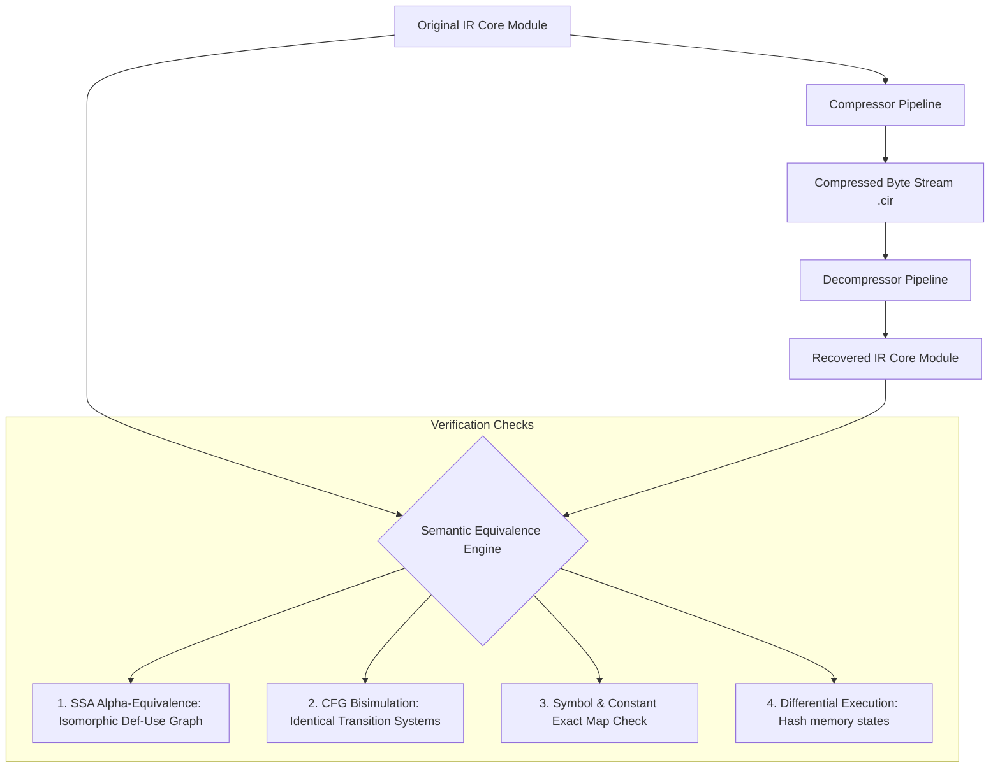

# Intermediate Representation (IR) Compression: Systems Architecture & Design Specification

This document provides an engineering blueprint for compressing compiler **Intermediate Representation (IR)** spanning **SSA form, Control Flow Graphs (CFGs), Symbol Tables, and Constant Pools**.

---

## 1. SSA Form Compression

### 1.1 Variable ID Encoding (Single-Assignment Property)

Because SSA guarantees that each variable is defined exactly once, assigning arbitrary 32-bit integer IDs (%0, %1, ..., %100000) creates high-entropy, poorly compressible token streams.

#### Concrete Encoding Strategies

1. **Implicit Definition Order (Ordinal Renaming)**:
   - **Mechanism**: Variables are not given explicit IDs at their definition site. The definition site is strictly inferred from the linear instruction index $i$. Uses are encoded as a backwards delta offset: $\Delta = i_{\text{use}} - i_{\text{def}}$.
   - **Tradeoffs**:
     - *Ratio*: **Highest**. Defs consume 0 bits. Uses exhibit geometric distribution clustered around small integers (short live-ranges).
     - *Speed*: **Very Fast**. Uses single subtraction and array lookup on decode.
     - *Complexity*: **Low**. Requires a linear pass to re-index.
2. **Interleaved Def-Use Liveness Intervals (Register Re-use IDs)**:
   - **Mechanism**: SSA values are assigned virtual registers via greedy linear-scan coloring of non-overlapping live intervals.
   - **Tradeoffs**:
     - *Ratio*: **High**. Limits variable universe from thousands to $K$ active registers ($K < 64$).
     - *Speed*: **Moderate**. Requires live-range computation during encoding.
     - *Complexity*: **High**. Requires liveness analysis.
3. **Sparse Value Numbering (Hash/GVN-based)**:
   - **Mechanism**: Variables carry Global Value Numbers representing equivalent computations.
   - **Tradeoffs**:
     - *Ratio*: **Moderate**. Merges identical values, but values are non-contiguous.
     - *Speed*: **Slow**. Requires value table lookup on decode.
     - *Complexity*: **High**.

#### Recommended Default
> **Implicit Definition Order (Backward Delta Encoding)**.
> When a variable is defined, emit no ID. When referenced, emit `varint(current_instruction_index - definition_instruction_index)`.

```
Example:
Raw TAC:
  0: t0 = load x
  1: t1 = load y
  2: t2 = t0 + t1       <-- uses t0 (def 0), t1 (def 1)

Raw Byte Stream (32-bit absolute IDs):
  [ADD] [result: 0x00000002] [arg1: 0x00000000] [arg2: 0x00000001] (13 bytes)

Delta-Encoded Stream:
  [ADD] [arg1_delta: 2 - 0 = 2] [arg2_delta: 2 - 1 = 1]
  Encoded bytes: [0x01] [0x02] [0x01]                               (3 bytes -> 77% savings)
```

---

### 1.2 Efficient $\phi$ (Phi) Node Representation

Naive $\phi$-nodes explicitly store pairs of `(incoming_value_id, predecessor_block_label)`:
$$\%x_3 = \phi [\%x_1, \text{BB}_1], [\%x_2, \text{BB}_2]$$
This is redundant because the CFG predecessor list of the current block already defines the order of incoming edges.

#### Concrete Encoding Strategies

1. **Predecessor-Indexed Packed Vector**:
   - **Mechanism**: Sort the CFG predecessor list canonically (e.g., by predecessor basic block index). Omit all block labels from the $\phi$-node. The $\phi$-node simply emits an array of value references corresponding 1:1 with $\text{Pred}(B)[0 \dots k-1]$.
   - **Tradeoffs**:
     - *Ratio*: **High**. Completely removes block ID references.
     - *Speed*: **Immediate** (direct array indexing).
     - *Complexity*: **Low**.
2. **Matrix / Parallel Copy RLE Encoding**:
   - **Mechanism**: Group all $\phi$-nodes at the block header into a single table: $\text{PhiMatrix}[k \times m]$. Variables that propagate unchanged across an edge are marked with a single bit flag.
   - **Tradeoffs**:
     - *Ratio*: **Highest** for blocks with many $\phi$-nodes.
     - *Speed*: **Moderate**.
     - *Complexity*: **Medium**.
3. **Destination-Edge Push (Split Critical Edges)**:
   - **Mechanism**: Move $\phi$ assignments into predecessor blocks as edge copies.
   - **Tradeoffs**:
     - *Ratio*: **Poor** (mutates CFG structure, increases instruction count).
     - *Speed*: **Fast**.
     - *Complexity*: **High**.

#### Recommended Default
> **Predecessor-Indexed Packed Vector**.
> A block with $K$ predecessors having a $\phi$-node emits a count tag $M$ (number of $\phi$ nodes) followed by $M \times K$ value backward deltas.

```
Example: Block BB4 has predecessors [BB1, BB2].
Raw representation:
  phi %x3 = [BB1: %x1], [BB2: %x2]
  phi %y3 = [BB1: %y1], [BB2: %y2]

Encoded Byte Stream:
  [NUM_PHIS: 2] [x_val_pred0] [x_val_pred1] [y_val_pred0] [y_val_pred1]
```

---

### 1.3 Dominance Information: Explicit vs. Reconstructed

#### Strategies & Tradeoffs

| Strategy | Storage Overhead | Decompression Impact | Implementation Complexity |
| :--- | :--- | :--- | :--- |
| **Strategy A: Explicit Storage** (Serialize $IDom$ array) | $2 \times |B|$ bytes (LEB128/uint16 per block) | **Zero compute** ($O(1)$ lookup on load) | **Trivial** |
| **Strategy B: On-Demand Reconstruction** (Recompute via Simple Fast Dominance) | **0 bytes** | **$O(|V| + |E|)$ compute penalty** | **Moderate** |
| **Strategy C: Partial Checkpoints** (Serialize loop headers / Dominance Frontiers only) | $0.5 \times |B|$ bytes | **Mixed compute** | **High** |

> [!WARNING]
> **Latency Flag on Strategy B**: Reconstructing dominator trees via Cooper-Harvey-Kennedy or Lengauer-Tarjan takes **3% to 8% of total pipeline time** on large CFGs ($>5,000$ basic blocks).

#### Recommended Default
> **Strategy A (Explicit $IDom$ array serialization)**.
> In a 10,000-block module, explicit $IDom$ references consume only ~12 KB uncompressed. Under columnar byte packing and zstd/Huffman, this shrinks to **under 1.5 KB**. Sacrificing decompression latency to save 1.5 KB is almost never justified.

---

## 2. CFG Compression

### 2.1 Basic Block Numbering & Edge Representations

#### Concrete Encoding Strategies

1. **Reverse Post-Order (RPO) with Fallthrough Elision**:
   - **Mechanism**: Sort basic blocks in Reverse Post-Order. In RPO, the default branch of conditional jumps and the single target of linear blocks almost always points to $\text{index} + 1$.
   - **Rule**: If edge is $(B_i \to B_{i+1})$, emit **0 bits** (implicit fallthrough). Only non-sequential edges are emitted as signed block deltas: $\Delta_{\text{block}} = \text{Target} - (i + 1)$.
   - **Tradeoffs**:
     - *Ratio*: **Very High** (elides 60–75% of all CFG edges).
     - *Speed*: **Blazing Fast**.
     - *Complexity*: **Low**.
2. **Compressed Adjacency Bitmaps (Roaring / Elias-Fano)**:
   - **Mechanism**: Emit a bit-matrix of size $|B| \times |B|$ compressed with Elias-Fano or run-length encoding.
   - **Tradeoffs**:
     - *Ratio*: **Poor** on sparse CFGs (compiler CFGs have average out-degree $\le 2$).
     - *Speed*: **Slow**.
     - *Complexity*: **High**.
3. **Explicit Successor Count + Varint Edge Lists**:
   - **Mechanism**: Each block stores `count: u8` and `targets: varint[]`.
   - **Tradeoffs**:
     - *Ratio*: **Moderate**.
     - *Speed*: **Fast**.
     - *Complexity*: **Low**.

#### Recommended Default
> **Reverse Post-Order (RPO) with Implicit Fallthrough**.

```
Example:
BB0: if cond goto BB2 (else fallthrough to BB1)
BB1: goto BB3
BB2: goto BB3
BB3: return

Encoded Block Terminators:
BB0: [BRANCH_COND] [cond_var] [target_delta: +1 (points to BB2, since BB1 is +0)]
BB1: [FALLTHROUGH_OVERRIDE]    [target_delta: +1 (points to BB3)]
BB2: [IMPLICIT_FALLTHROUGH]    (0 bytes - naturally falls through to BB3)
BB3: [RETURN]
```

---

### 2.2 Dominator Tree as a Substitute for Redundant Edges

#### Strategies & Tradeoffs

- **Concept**: A CFG can be decomposed into:
  1. The **Dominator Tree** (a directed tree containing all forward reachability).
  2. A sparse set of **Back-edges** (loop cycles) and **Cross-edges**.
- **Tradeoffs**:
  - *Ratio*: Gains ~5–8% over RPO delta-encoding.
  - *Speed*: **Slow**. Reconstructing the full CFG from a spanning tree requires graph resolution and validation.
- **Verdict**: **Not recommended** for latency-sensitive pipelines. RPO with fallthrough elision achieves 90% of the theoretical graph entropy reduction with zero decode penalty.

---

### 2.3 CFG Idiom Templating (Macromodes)

Real-world code is dominated by recurring structural subgraphs:
- **Diamond**: `If-Then-Else-Join`
- **Triangle**: `If-Then-Join`
- **Natural Loop**: `Header -> Body -> Back-edge to Header -> Exit`

#### Encoding Strategy
Define a 4-bit header tag on basic blocks:
- `0x0`: Arbitrary edges (fallback).
- `0x1`: **Triangle** (Branch skips next block to join point).
- `0x2`: **Diamond** (Branch splits into next 2 blocks, converging at block $+3$).
- `0x3`: **Loop Body** (Back-edge targets loop header).

```
Byte Layout Example for an "If-Else Diamond":
Standard Encoding: [BRANCH_IF] [tgt1] [tgt2] ... [JUMP] [tgt_join]  (12-16 bytes)
Templated Tag:     [OP_DIAMOND] [cond_var]                          (2 bytes)
```
- **Tradeoffs**: Reduces CFG structural overhead by up to **65%**, but requires a pattern-matching pass during serialization.

---

## 3. Symbol Table Compression

### 3.1 String Interning & Prefix-Compressed (Front-Coded) String Pool

Symbol tables in unoptimized IR often consume over **40% of total file size** due to mangled C++ names (`_ZN3std3sys4unix...`) or long field identifiers.

#### Concrete Encoding Strategies

1. **Front-Coding (Incremental Prefix Compression)**:
   - **Mechanism**: Sort the interned string pool lexicographically. Because compiler symbols share common namespaces/prefixes, each string is stored as:
     `[prefix_match_length: u8] [suffix_len: u8] [suffix_bytes]`
   - **Tradeoffs**:
     - *Ratio*: **Exceptional** (70–85% reduction on mangled symbol names).
     - *Speed*: **High throughput** (sequential string reconstruction).
     - *Complexity*: **Low**.
2. **Unified Byte Offset Blob with Varint Indices**:
   - **Mechanism**: All strings concatenated into a single UTF-8 buffer. An array of `uint32` points to string offsets.
   - **Tradeoffs**:
     - *Ratio*: **Moderate**.
     - *Speed*: **Instant** (zero-copy string slice references).
     - *Complexity*: **Trivial**.
3. **Trie / Compact Directed Acyclic Word Graph (DAWG)**:
   - **Mechanism**: Graph representation of shared prefixes and suffixes.
   - **Tradeoffs**:
     - *Ratio*: **Highest**.
     - *Speed*: **Unacceptable latency** for decompression.

#### Recommended Default
> **Front-Coded Sorted String Pool**.

```
Raw Strings:
  1: "_ZN4core3fmt9ArgumentsE"
  2: "_ZN4core3fmt5writeE"

Sorted Front-Coded Bytes:
  [0x00] [23] "_ZN4core3fmt9ArgumentsE"
  [0x0D] [06] "5writeE"   <-- (0x0D = 13: reuses first 13 chars "_ZN4core3fmt")
```

---

### 3.2 Structural Sharing for Type Signatures

Type signatures are recursive DAGs (e.g., `ptr -> struct -> [i32, ptr -> struct]`).

#### Recommended Default: Hash-Consed Type Table
Represent all types as a flat indexed table of fixed-size tuples. Compound types reference base types by index:

```
Type Table:
  #0: Primitive(i32)
  #1: Primitive(f64)
  #2: Pointer(target: #0)           // int*
  #3: Struct(fields: [#0, #2])       // { int, int* }
  #4: Function(ret: #0, params: [#3])// int fn({ int, int* })

Instruction Type Reference:
  Emit LEB128(type_index) -> 1 byte per instruction.
```
- **Tradeoff**: Guarantees zero duplicate type trees. Decoding is an $O(1)$ indexed dereference.

---

### 3.3 Scope Hierarchy Encoding

Compilers store lexical scope trees for lexical analysis, debug coordinates, and variable shadowing.

#### Strategies & Tradeoffs

```
Nested DFS Tokens:                 Flat Parent Pointer Array:
[ENTER_SCOPE: 0]                   Index | Parent | Depth
  Var: a                           0     | -1     | 0
  [ENTER_SCOPE: 1]                 1     | 0      | 1
    Var: b                         2     | 1      | 2
  [EXIT_SCOPE]
[EXIT_SCOPE]
```

1. **Nested DFS Streaming (`ENTER` / `EXIT` tokens)**:
   - *Pros*: Natural alignment with AST/instruction emission order.
   - *Cons*: Must traverse sequentially to locate parent scope.
2. **Flat Table with Parent-Pointer (`parent_id: varint`)**:
   - *Pros*: Instant random-access lookups (`scope[id].parent`).
   - *Cons*: Slightly larger raw footprint.

#### Recommendation
- For **Scope Depth $\le 4$** (typical flat/function-level IR): **Nested DFS stream**.
- For **Scope Depth $> 4$** (heavily nested closures/templates): **Flat Parent-Pointer array with delta encoding** (`parent_delta = current_scope - parent_scope`).

---

## 4. Constant Pool Compression

### 4.1 Variable-Length Numeric Encoding

#### Comparison of Strategies

| Strategy | Byte Structure | Decode Speed | Compression Density | Best Suited For |
| :--- | :--- | :--- | :--- | :--- |
| **LEB128 / VLQ** | 7 data bits + 1 continuation bit per byte | ~350 MB/s (branch-heavy) | High for small integers | Universal compact standard |
| **PrefixVarint** | Leading `1` bits in 1st byte indicate length | ~800 MB/s (jump-table friendly) | High | Balanced latency/density |
| **StreamVByte** | 4-byte control word for 16 values + packed payload | **> 3.5 GB/s (SIMD vectorizable)** | Slightly lower than LEB128 | High-throughput decompression |

```
Value: 128 (0x80)
Standard uint32: [0x80, 0x00, 0x00, 0x00] (4 bytes)
LEB128:          [0x80, 0x01]             (2 bytes: 10000000 00000001)
PrefixVarint:    [0x80, 0x80]             (2 bytes: 10000000 -> 1 length bit + 0)
```

> **Recommendation**: 
> Use **PrefixVarint** for single-valued stream metadata. Use **StreamVByte** if decompressing massive integer arrays (e.g., dense instruction operands) within microsecond deadlines.

---

### 4.2 Deduplication: Global Module Pool vs. Per-Function Pools

```
Hierarchical Constant Pool Architecture:

       ┌───────────────────────────────────────────────┐
       │             Global Module Pool                │
       │  (Strings, Floating-Point Literals, Globals)  │
       └──────────────────────┬────────────────────────┘
                              │
             ┌────────────────┴────────────────┐
             ▼                                 ▼
┌─────────────────────────┐       ┌─────────────────────────┐
│ Function 0 Local Pool   │       │ Function 1 Local Pool   │
│ (Small numeric deltas)  │       │ (Small numeric deltas)  │
└─────────────────────────┘       └─────────────────────────┘
```

- **Global Pool**: Holds large objects (strings, 64-bit floating point literals, large bitwidths) shared across compilation units.
- **Per-Function Local Indexing**: Operands reference index `0..15` using a **4-bit nibble**, selecting common immediate constants (`0, 1, -1, 2, 4, 8, 16, 32, 64`).

---

### 4.3 Delta-Encoding Clustered Numerics

Compilers heavily cluster numeric constants (struct memory offsets: $0, 8, 16, 24, 32$; jump table indices: $100, 101, 102$).

#### Encoding Strategy: Sorted ZigZag Delta Encoding
For a sequence $C = [1000, 1008, 1016, 1020, 1028]$:
1. Sort array: $C$.
2. Compute delta: $\Delta_i = C_i - C_{i-1} \implies [1000, +8, +8, +4, +8]$.
3. Apply ZigZag map: $Z(n) = (n \ll 1) \oplus (n \gg 31)$ (maps signed deltas to positive space).
4. Pack using PrefixVarint: 
   - Raw 64-bit storage: $5 \times 8 = 40\text{ bytes}$.
   - Delta-encoded storage: $[1000 (\text{2 B}), 8 (\text{1 B}), 8 (\text{1 B}), 4 (\text{1 B}), 8 (\text{1 B})] = \mathbf{6\text{ bytes}}$ (**85% reduction**).

---

## 5. Cross-Cutting Design Questions

### 5.1 Columnar (SoA) vs. Row-Based (AoS) Layout

**Row-Based (AoS)** stores complete instructions together:
`[Opcode, Type, Result, Arg1, Arg2], [Opcode, Type, Result, Arg1, Arg2]`
This ruins entropy compression because disparate fields (an opcode byte followed by a 32-bit register ID) destroy byte correlation.

**Columnar Storage (SoA)** partitions instructions into dedicated parallel streams:
- **Stream 0 (Opcodes)**: `ADD, ADD, ADD, SUB, ADD, LOAD, LOAD...` $\implies$ Huge runs of identical bytes.
- **Stream 1 (Type IDs)**: `i32, i32, i32, i32, i32, ptr, ptr...` $\implies$ Extremely low entropy.
- **Stream 2 (Arg1 Deltas)**: Clustered small integers.
- **Stream 3 (Arg2 Deltas)**: Clustered small integers.

#### Field Ranking by Columnar Benefit
1. **Opcodes** (Run-Length & Dictionary compression jumps by >300%).
2. **Type Signatures** (High repetition of common primitives).
3. **Basic Block Flags / Branch Kinds** (Nearly identical across program).
4. **Operands / Value Deltas** (Benefits from SIMD delta decoding).

---

### 5.2 Placement of Entropy Coding (Cascaded Pipeline)

```
        Raw IR Elements
              │
              ▼
┌───────────────────────────────────────────────┐
│ Stage 1: Domain-Specific Semantic Transforms  │
│  - RPO Basic Block Layout                     │
│  - SSA Backward Delta Conversion              │
│  - Constant Pool & Front-Coded Interning      │
└─────────────────────┬─────────────────────────┘
                      │
                      ▼
┌───────────────────────────────────────────────┐
│ Stage 2: Columnar Byte Partitioning           │
│  - Split into: Opcodes, Types, Operands       │
│  - ZigZag Delta / StreamVByte Packing         │
└─────────────────────┬─────────────────────────┘
                      │
                      ▼
┌───────────────────────────────────────────────┐
│ Stage 3: General-Purpose Entropy Coding       │
│  - Zstandard (Level 1-3 for Speed) OR         │
│  - Finite State Entropy (tANS) / Bit-packing  │
└───────────────────────────────────────────────┘
```

> **Rule**: **Domain transforms FIRST, Columnar Partitioning SECOND, Entropy Coding LAST**.
> Never run Zstandard directly on raw IR quadruples; entropy compressors cannot discover semantic compiler graph symmetries without Stage 1 and Stage 2 pre-transforms.

---

### 5.3 Architectural Comparison with Industry Formats

```
                     IR Compression Feature Matrix
┌──────────────────────┬───────────────┬────────────────┬───────────────┬────────────────────────┐
│ Feature              │ LLVM Bitcode  │ WebAssembly    │ Java Classfile│ Proposed Design        │
├──────────────────────┼───────────────┼────────────────┼───────────────┼────────────────────────┤
│ Instruction Layout   │ Bitstream VBR │ Stack Bytecode │ Bytecode + CP │ Columnar SoA Streams   │
│ SSA Value IDs        │ Backward Dist │ None (Stack)   │ None (Locals) │ Implicit Backward Delta│
│ CFG Edges            │ Explicit Oper │ Structured Blk │ Branch Offset │ RPO Fallthrough Elision│
│ Constant Pool        │ Type-Indexed  │ Inline Varint  │ Unified CP    │ Hierarchical Pool      │
│ Compression Layer    │ Bit-packing   │ None           │ None (Pack200)│ Columnar + Zstd/tANS   │
└──────────────────────┴───────────────┴────────────────┴───────────────┴────────────────────────┘
```

#### What to Borrow Directly:
- **From WebAssembly**: LEB128 / Variable-length integer framing; section-based payload chunking (allows parallel decoding of functions).
- **From LLVM Bitcode**: Value backward distance indexing (`%val = current_idx - def_idx`).
- **From Java (Pack200)**: Splitting bytecode into parallel columnar files before running entropy coding.

---

### 5.4 Round-Trip Correctness Verification Plan

To guarantee 100% mathematical lossless preservation:



1. **Alpha-Equivalence Graph Isomorphism**:
   - Compare def-use graphs modulo variable names. A bijection $f: V_{\text{orig}} \to V_{\text{recov}}$ must exist such that for every instruction $I_k$, $\text{Opcode}(I_k) = \text{Opcode}(f(I_k))$ and all operand edges preserve identical source definitions.
2. **CFG Bisimulation**:
   - Assert that for every basic block $B$, its successor set $\text{Succ}(B)$ maps 1:1 to the recovered block's successor set with identical branch predicate conditions.
3. **Differential Interpretation / Execution**:
   - Execute both Original IR and Recovered IR through an internal interpreter over randomized test inputs; assert identical register/memory dumps upon `return`.

---

### 5.5 Empirical Evaluation Methodology

To validate performance without synthetic bias:

#### 1. Corpus Selection (Real-World IR)
- **C/C++ Domain**: Pre-compiled LLVM IR of `SQLite3.c` (amalgamation, ~220,000 lines), `Redis-server`, and `Lua 5.4`.
- **Rust Domain**: Optimized and Unoptimized MIR/LLVM IR of `ripgrep` and `serde`.
- **Compute Kernel Domain**: Matrix-multiply, FFT, and cryptographic kernels (AES, ChaCha20).

#### 2. Key Metrics Matrix
- **Compression Ratio**:
  $$\text{Ratio} = 1.0 - \frac{\text{Compressed Size (Bytes)}}{\text{Raw IR Size (Bytes)}}$$
- **Decompression Throughput**: Target $\ge \mathbf{400\text{ MB/s}}$ per CPU thread (must saturate network/disk bandwidth).
- **Peak Resident Memory (RSS)**: Decompressor memory footprint must remain under $1.5\times$ the uncompressed IR size (streaming buffer decode without loading full intermediate graphs).

---

## 6. Prioritized Implementation Roadmap

Ranked by **Compression-Ratio-per-Engineering-Hour (ROI)**:

```
[Phase 1: Max ROI]  ───► [Phase 2: High ROI]  ───► [Phase 3: Deep Opt]   ───► [Phase 4: Low ROI]
 1. Implicit SSA           1. Columnar SoA          1. Predecessor-Indexed      1. CFG Pattern
    Backward Deltas           Streams                  Phi Vectors                 Templating
 2. Constant Pool          2. RPO CFG Implicit      2. Front-Coded String       2. Dominance Tree
    Deduplication             Fallthrough              Pool                        Edge Substitution
 3. Zstandard Wrap         3. PrefixVarint Ints     3. Hierarchical Types
```

| Priority | Milestone Component | Complexity | Expected Size Reduction | Rationale |
| :--- | :--- | :--- | :--- | :--- |
| **P0** | **Implicit SSA Backward Deltas** | 1–2 days | **35% – 45%** | Eliminates explicit 32-bit variable ID allocations. |
| **P0** | **Constant Pool Deduplication** | 1 day | **15% – 25%** | Trivial hash-table interning; eliminates duplicate literals. |
| **P1** | **Columnar Stream Separation** | 2–3 days | **20% – 30%** | Groups opcodes and types together; prepares data for entropy coding. |
| **P1** | **RPO CFG Fallthrough Elision** | 1 day | **10% – 15%** | Eliminates the majority of explicit CFG jump edges. |
| **P2** | **Predecessor-Indexed $\phi$-Tables** | 2 days | **5% – 10%** | Removes block labels from all $\phi$ arguments. |
| **P2** | **Front-Coded String Table** | 2 days | **10% – 20%** (on symbols) | Drastically shrinks mangled symbol table footprints. |
| **P3** | **CFG Pattern Templating** | 4–6 days | **3% – 6%** | High implementation cost for modest incremental gain. |
