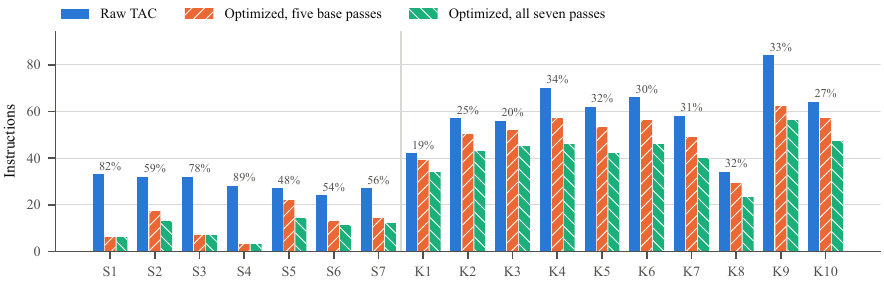
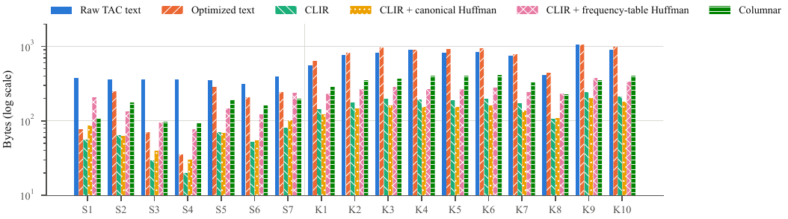
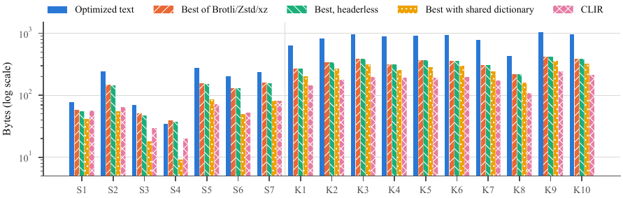
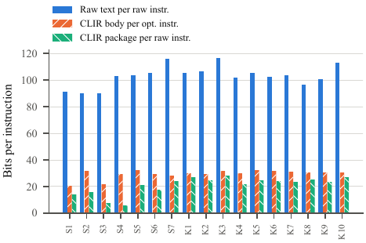
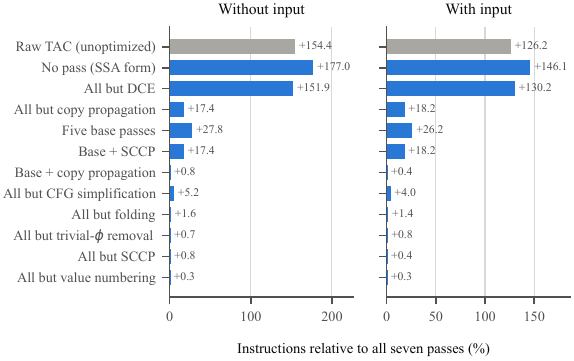
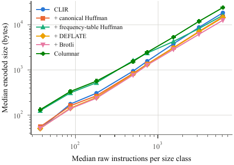
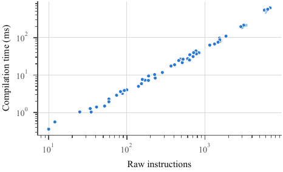

# Results

Experimental results, evaluation metrics and sample outputs of IR Compression Studio. All numbers come from the raw result files in [`../paper_eval/results/`](../paper_eval/results/) and match the manuscript in [`../manuscript/`](../manuscript/). Regenerate everything with `bash scripts/reproduce_results.sh`.

## Evaluation metrics

| Metric | Definition |
|---|---|
| Instruction reduction | R(a, b) = 100 · (a − b) / a for instruction counts before and after optimization |
| Size reduction | the same formula applied to bytes, e.g. CLIR against a compressed text |
| Encoding density | bits per instruction, 8 · bytes / instructions |
| Entropy-coding overhead | share of the Huffman header in the coded output |
| Compilation throughput | raw instructions compiled per second |
| Agreement rate | % of programs whose optimized code prints the same output as the raw code |

## 1. Benchmarks (dataset: `benchmarks/`)

Seven demonstration programs (S1–S7) and ten C kernels that read input and call functions (K1–K10, `benchmarks/kernels/`). Compressor columns: the best of Brotli, Zstandard and xz applied to the *optimized* program as text, framed (normal files) and with a shared 4 KB dictionary.

| ID | Program | Raw instr. | Opt. instr. | Reduction | Raw TAC text (B) | Opt. text (B) | CLIR (B) | Best framed (B) | CLIR vs framed | Best with dictionary (B) | CLIR vs dictionary |
|---|---|---|---|---|---|---|---|---|---|---|---|
| S1 | `sample1_arithmetic_constants.lang` | 33 | 6 | 81.8% | 376 | 77 | 56 | 58 | 3.4% | 41 | -36.6% |
| S2 | `sample2_loops_and_conditionals.lang` | 32 | 13 | 59.4% | 360 | 244 | 63 | 147 | 57.1% | 55 | -14.5% |
| S3 | `sample3_redundant_gvn.lang` | 32 | 7 | 78.1% | 360 | 70 | 29 | 51 | 43.1% | 18 | -61.1% |
| S4 | `sample4_dead_code.lang` | 28 | 3 | 89.3% | 360 | 35 | 20 | 39 | 48.7% | 9 | -122.2% |
| S5 | `sample5_matrix_fibonacci.lang` | 27 | 14 | 48.1% | 350 | 280 | 70 | 155 | 54.8% | 84 | 16.7% |
| S6 | `sample6_standard_cfg_demo.lang` | 24 | 11 | 54.2% | 317 | 205 | 52 | 129 | 59.7% | 49 | -6.1% |
| S7 | `sample7_standard_c_program.c` | 27 | 12 | 55.6% | 391 | 240 | 81 | 157 | 48.4% | 81 | 0.0% |
| K1 | `k01_gcd_lcm.c` | 42 | 34 | 19.0% | 555 | 635 | 141 | 264 | 46.6% | 200 | 29.5% |
| K2 | `k02_isqrt.c` | 57 | 43 | 24.6% | 761 | 815 | 174 | 336 | 48.2% | 263 | 33.8% |
| K3 | `k03_modpow.c` | 56 | 45 | 19.6% | 817 | 964 | 195 | 382 | 49.0% | 314 | 37.9% |
| K4 | `k04_bitcount.c` | 70 | 46 | 34.3% | 891 | 900 | 190 | 314 | 39.5% | 255 | 25.5% |
| K5 | `k05_collatz.c` | 62 | 42 | 32.3% | 818 | 915 | 189 | 360 | 47.5% | 278 | 32.0% |
| K6 | `k06_primes.c` | 66 | 46 | 30.3% | 847 | 943 | 197 | 357 | 44.8% | 292 | 32.5% |
| K7 | `k07_fibonacci.c` | 58 | 40 | 31.0% | 753 | 778 | 170 | 304 | 44.1% | 237 | 28.3% |
| K8 | `k08_adler32.c` | 34 | 23 | 32.4% | 411 | 436 | 106 | 216 | 50.9% | 159 | 33.3% |
| K9 | `k09_day_of_week.c` | 84 | 56 | 33.3% | 1059 | 1039 | 243 | 414 | 41.3% | 354 | 31.4% |
| K10 | `k10_iir_filter.c` | 64 | 47 | 26.6% | 906 | 976 | 212 | 379 | 44.1% | 323 | 34.4% |

- Optimization removes **48.1% – 89.3%** of the instructions of S1–S7 (mean 66.6%) but only **19.0% – 34.3%** of the kernels (mean 28.3%).
- CLIR is **3.4% – 59.7%** smaller than the best framed compressor on S1–S7 and **39.5% – 50.9%** smaller on K1–K10.
- With a shared dictionary the compressors win on 5 of the 7 small programs (S1, S2, S3, S4, S6); CLIR still wins on all 10 kernels (25.5% – 37.9%).
- For every benchmark the raw code, the optimized code and the decoded CLIR print identical output (see `sample_outputs/`).

## 2. Ablation: what each pass contributes (200 synthetic programs)

All seven passes reduce 64,048 raw instructions to 25,173 (−60.7%). Turning one pass off increases the result by:

| Pass disabled | Increase |
|---|---|
| Dead-code elimination | +151.9% |
| Copy propagation | +17.4% |
| CFG simplification | +5.2% |
| Constant folding | +1.6% |
| SCCP | +0.8% |
| Trivial-φ removal | +0.7% |
| Value numbering | +0.3% |

## 3. Huffman coding and scaling (64 synthetic programs)

- Canonical Huffman coding was no smaller than its input for every CLIR package of up to 81 bytes and smaller for every package of 115 bytes or more; it made 11 of the 17 benchmark packages smaller.
- The break-even model, applied program by program, classified all 64 synthetic programs correctly for the canonical Huffman header.
- CLIR beat the best framed compressor on 46 of the 64 programs (−10.3% to 58.3%).

## 4. Compilation time

1.01 – 3.96 ms per benchmark, including both encoders; on synthetic programs the time grows with exponent 1.15 of program size.

## 5. Correctness: differential testing (1,000 random programs, 325,719 instructions)

| Optimizer | Agree | Differ |
|---|---|---|
| First release (division folded with Python floor semantics) | 787 (78.7%) | 213 (21.3%) |
| Current release (C truncating division) | 1,000 (100%) | 0 |

The corrected optimizer also agrees on 500 further random programs that read input.

## Sample outputs

[`sample_outputs/`](sample_outputs/) has one file per benchmark: source, input, raw three-address code, optimized SSA code, pass statistics, sizes and the program output before optimization, after optimization and after decoding the CLIR bytecode. They are produced by `paper_eval/sample_outputs.py`.

## Other figures

- [`figures/fig_architecture.png`](figures/fig_architecture.png): system architecture
- [`figures/fig_flow.png`](figures/fig_flow.png): processing flow
- [`figures/web_studio_screenshot.jpg`](figures/web_studio_screenshot.jpg): web studio
