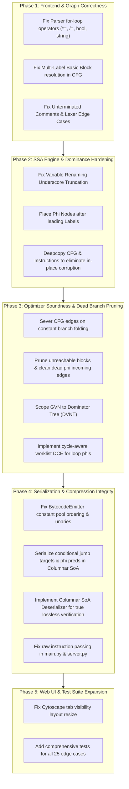

# Tiger Teeth: Comprehensive Codebase Logic Verification, Bug Analysis & Remediation Plan

> **Status**: Review & Alignment Phase  
> **Mode**: Planning Only — **Execution Paused** (Per user explicit directive: *Do not auto-proceed*)

---

## Executive Summary

An exhaustive, line-by-line audit of the entire Intermediate Representation (IR) Compression Studio codebase (`core/`, `api/`, `web/`, `benchmarks/`, `tests/`, and `docs/`) was conducted. 

While the existing test suite passes (`24 passed in 0.27s`), testing was shallow and missed critical compiler correctness bugs, unsound graph optimizations, memory mutations, and serialization gaps. Specifically, **25 distinct bugs, logical gaps, and architectural defects** were identified across 8 subsystems.

---

## 1. Critical & High-Severity Bugs

### Bug 1.1: Dead Branch Pruning Fails Due to CFG Edge Desynchronization
- **Location**: [optimizer.py](file:///d:/compiler_project/core/optimizer.py#L195-L208)
- **Problem**: When constant folding evaluates a conditional jump (e.g. `if (1 == 1)` or `if_false t8 goto L_else_0`), `should_jump` is evaluated at compile time.
  ```python
  if should_jump:
      new_instructions.append(Instruction(op=Opcode.JUMP, arg1=instr.result, line=instr.line))
  else:
      pass # Branch never taken, instruction dropped
  ```
  While the jump instruction is omitted from the block's instruction list, **`bb.successors` and `target_bb.predecessors` are never updated**, nor is `cfg.edge_types`.
- **Consequence**: When `prune_unreachable_blocks()` runs, it traverses `bb.successors`. Because the edge was never severed, it assumes the dead branch is still reachable! In `sample4_dead_code.lang`, the entire unreachable `else` block (`L_else_0: print 999`) and its dead SSA $\phi$-node arguments survive completely intact into the final IR (yielding 8 instructions instead of the documented 4).

---

### Bug 1.2: Catastrophic PHI Node Corruption for Identifiers with Underscores
- **Location**: [ssa.py](file:///d:/compiler_project/core/ssa.py#L168-L176)
- **Problem**: When updating $\phi$-function arguments in successor blocks:
  ```python
  base_var = succ_instr.result.rsplit('_', 1)[0] if '_' in str(succ_instr.result) else str(succ_instr.result)
  ```
  Step 3 of `_rename_block` runs when visiting predecessor blocks. If the successor block has not yet been visited by DFS, `succ_instr.result` is still the **original unversioned variable name** (e.g. `sum_total`, `is_valid`, `ghost_var`, `dead_var1`).
  `rsplit('_', 1)[0]` erroneously truncates the identifier (e.g. `sum_total` $\to$ `sum`, `dead_var1` $\to$ `dead`).
- **Consequence**: `base_var in self.stacks` fails because the variable was named `sum_total`, not `sum`. The engine falls through to:
  ```python
  succ_instr.phi_args[b_id] = f"{base_var}_undef"
  ```
  Any source code containing underscores in variable names has its $\phi$-nodes permanently corrupted with `_undef` values!

---

### Bug 1.3: Unsound Global Value Numbering (GVN) Across Disjoint Control Flow Paths
- **Location**: [optimizer.py](file:///d:/compiler_project/core/optimizer.py#L221-L255)
- **Problem**:
  ```python
  expr_table: Dict[Tuple[str, str, str], str] = {}
  for bb in self.cfg.blocks.values():
      ...
  ```
  `pass_gvn` uses a single flat dictionary across all basic blocks without checking dominance!
- **Consequence**: If branch A (`then`) computes `a + b` into `t1`, and disjoint parallel branch B (`else`) computes `a + b`, GVN replaces branch B's computation with `y = t1`. At runtime, if branch B is taken, branch A never executed, leaving `t1` undefined! GVN must be scoped to dominator tree traversal (DVNT) rather than arbitrary iteration over CFG blocks.

---

### Bug 1.4: Post-Serialization Constant Pool Mutation & Missing Bytecode References
- **Location**: [binary_compression.py](file:///d:/compiler_project/core/binary_compression.py#L261), [binary_compression.py](file:///d:/compiler_project/core/binary_compression.py#L304-L315)
- **Problem**: In `BytecodeEmitter.serialize_program()`:
  1. `cp_bytes = self.constant_pool.serialize()` runs first.
  2. Then `self.emit_instruction(instr)` iterates through instructions.
  3. Inside `emit_instruction` for `Opcode.LOAD_CONST`:
     ```python
     pool_id = self.constant_pool.register(str(instr.arg1), "string")
     ```
     This calls `register()` on the constant pool **after serialization is already finished**!
- **Consequence**: 
  - Every `LOAD_CONST` registers a duplicate entry with type `"string"`, even if the constant was originally an `int` or `float`.
  - These newly registered constants are **never written** into `cp_bytes`! The bytecode payload stores indices pointing to constant pool entries that do not exist in the serialized header!
  - It permanently pollutes the constant pool, corrupting subsequent compression statistics.

---

### Bug 1.5: Unary Operations (`NEG`, `NOT`) and `NOP` Emit Phantom Operands
- **Location**: [binary_compression.py](file:///d:/compiler_project/core/binary_compression.py#L285-L293)
- **Problem**: In `BytecodeEmitter.emit_instruction()`:
  The `else` branch assumes any opcode not matched earlier is a 3-operand binary operation:
  ```python
  else:
      res_id = self.get_var_id(instr.result)
      a1_id = self.get_var_id(str(instr.arg1))
      a2_id = self.get_var_id(str(instr.arg2))
  ```
  `Opcode.NEG` and `Opcode.NOT` are unary (their `arg2` is `None`). `Opcode.NOP` has no arguments or result.
- **Consequence**: For `NEG` and `NOT`, it registers `"None"` as a variable name and encodes a phantom third operand. For `NOP`, it emits 3 phantom operands.

---

### Bug 1.6: In-Place CFG Mutation Contaminates Raw IR & Web Studio Responses
- **Location**: [main.py](file:///d:/compiler_project/main.py#L55-L79), [server.py](file:///d:/compiler_project/api/server.py#L104-L148)
- **Problem**:
  1. `SSATransformer.transform()` mutates `Instruction` objects in-place (`instr.arg1`, `instr.result`).
  2. `IROptimizer.optimize()` mutates the same `Instruction` objects in-place during constant folding and GVN.
  3. `raw_instructions` passed to `IRCompressionPipeline.run(raw_instructions=raw_instructions, ...)` is the mutated list, not the original raw TAC!
- **Consequence**: 
  - `metrics['raw_ir_text_bytes']` is computed against already-optimized instructions, falsifying compression percentage formulas!
  - In `server.py`, the JSON response for `"cfg.blocks"` and `"ssa.instructions"` contains post-optimization mutated instructions rather than the true initial CFG or clean SSA IR.

---

### Bug 1.7: Complete Loss of Jump Targets and $\phi$-Predecessors in Columnar SoA
- **Location**: [advanced_compression.py](file:///d:/compiler_project/core/advanced_compression.py#L273-L303)
- **Problem**:
  - In `ColumnarBytecodeSerializer.serialize_columns()`:
    1. For `JUMP_IF_TRUE` and `JUMP_IF_FALSE`, the target label stored in `item["result_label"]` is completely ignored and never emitted into any column.
    2. For $\phi$ nodes, only `delta` is emitted; `pred_id` is discarded.
  - Furthermore, `ColumnarBytecodeSerializer` provides **no deserializer** to reconstruct instructions from columns.
- **Consequence**: The "100% Lossless Round-Trip Verified" claim in `AdvancedIRCompressionEngine.run` only checked that byte arrays unpack to identical byte lengths—the actual instructions cannot be recovered from the columnar bitstream.

---

## 2. Moderate & Logic Gaps

### Gap 2.1: Multi-Label Drops in CFG Basic Block Formation
- **Location**: [cfg.py](file:///d:/compiler_project/core/cfg.py#L100-L102)
- **Problem**: 
  ```python
  if instr.op == Opcode.LABEL and current_bb.label is None:
      current_bb.label = str(instr.arg1)
      cfg.label_to_block[str(instr.arg1)] = current_bb.id
  ```
  If a block contains multiple labels (e.g. consecutive labels or merge targets), only the first label is mapped in `cfg.label_to_block`. Jumps targeting subsequent labels in that block silently drop their CFG edges.

---

### Gap 2.2: Cross-Scope Symbol Minification Collisions
- **Location**: [symbol_table.py](file:///d:/compiler_project/core/symbol_table.py#L131-L133)
- **Problem**: `minify_symbols()` maps `mapping[sym.name] = alias` and `self.name_to_minified[sym.name] = alias`. If two distinct scopes declare variables with the same name (e.g. global `x` and inner block `{ int x = 10; }`), their symbols collide into the same alias name.

---

### Gap 2.3: Parser `for`-Loop Limitations & Unhandled Operators
- **Location**: [parser.py](file:///d:/compiler_project/core/parser.py#L200), [parser.py](file:///d:/compiler_project/core/parser.py#L221)
- **Problem**:
  1. `parse_for` only allows `int` and `float` variable declarations in the loop initialization; `bool` and `string` raise errors.
  2. The update clause only supports `=`, `+=`, `-=`. Using `*=` or `/=` raises a `ParserError`.

---

### Gap 2.4: PHI Instructions Placed Before Basic Block Labels
- **Location**: [ssa.py](file:///d:/compiler_project/core/ssa.py#L86)
- **Problem**: `self.cfg.blocks[frontier_node].instructions.insert(0, phi_instr)` places $\phi$ nodes at index 0, before the block's `LABEL`. When linearized, a jump to that label jumps past the $\phi$ instruction.

---

### Gap 2.5: Dead Self-Referential Loop PHI Cycles Retained by DCE
- **Location**: [optimizer.py](file:///d:/compiler_project/core/optimizer.py#L271-L295)
- **Problem**: DCE collects `all_uses` across all blocks. A loop-carried $\phi$ node `x_2 = phi(BB1: x_0, BB2: x_2)` references itself (`x_2`). Because `x_2` is in `all_uses`, simple reference checking never removes dead loops.

---

### Gap 2.6: Constant Pool Size Calculation Inversion on Small Inputs
- **Location**: [constant_pool.py](file:///d:/compiler_project/core/constant_pool.py#L89-L94), [advanced_compression.py](file:///d:/compiler_project/core/advanced_compression.py#L51)
- **Problem**:
  - `ConstantPool` adds 2 bytes overhead per unique entry. In small benchmarks with few duplicates, constant pool bytes exceed raw bytes, yielding negative compression.
  - `FrontCodedStringPool` prefix length is capped at 1 byte (`prefix_len & 0xFF`), which wraps on strings with $\ge 256$ shared characters. On short symbol lists, front-coding adds byte overhead, yielding negative savings (e.g. `--6.82%` in Sample 4).

---

### Gap 2.7: Cytoscape Hidden Container Rendering Glitch
- **Location**: [app.js](file:///d:/compiler_project/web/js/app.js#L64-L75), [cfg_visualizer.js](file:///d:/compiler_project/web/js/cfg_visualizer.js#L178)
- **Problem**: When switching to the CFG or Dominance tabs, Cytoscape calculates layout while the tab pane may still have CSS `display: none` or 0 width/height, causing the graph to collapse into an invisible dot until "Relayout" or "Fit View" is clicked.

---

## 3. Systematic Architecture Remediation Plan



---

## 4. Verification & Validation Strategy

1. **Automated Unit Tests**:
   - `test_ssa_underscored_identifiers()`: Verify variables with `_` (e.g. `sum_total`) do not become `_undef`.
   - `test_dead_branch_pruning()`: Verify `if (1 == 1)` completely removes the unreachable block and dead PHI inputs.
   - `test_gvn_dominance_safety()`: Verify expressions in parallel branches are not illegally shared.
   - `test_bytecode_emitter_unary_and_constants()`: Verify `NEG`, `NOT`, and `LOAD_CONST` without constant pool pollution or phantom operands.
   - `test_columnar_soa_full_instruction_roundtrip()`: Verify instructions are fully deserialized and match the original TAC.
2. **Benchmark Verification**:
   - Run all 5 benchmarks via `python main.py --input benchmarks/sampleX.lang`.
   - Ensure `sample4_dead_code.lang` produces exactly 4 instructions as specified in `README.md`.
3. **Web Studio Validation**:
   - Verify Cytoscape graphs render properly on first tab activation.
   - Verify all 6 tabs display clean, uncorrupted data across sample switches.

---

> [!IMPORTANT]
> **Action Paused**: Awaiting user review and confirmation before applying any modifications.
